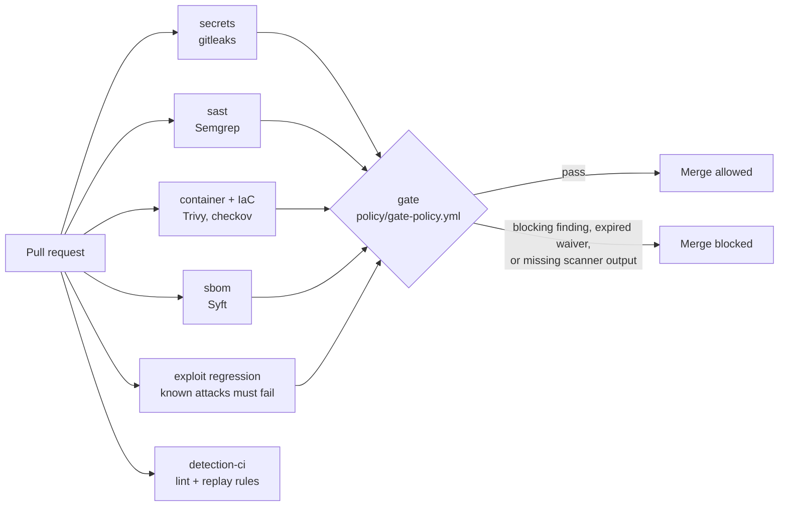

# payloop-secure-pipeline: a CI/CD gate that blocks bad code, and detections tested as code

A GitHub Actions pipeline for the fictional **PayLoop** payments API. Pull requests are scanned for secrets, code flaws, vulnerable
dependencies and container misconfiguration; **one policy** decides whether the merge is allowed. The same repository tests the Wazuh
detection rules like software: lint, replay attacks, and prove benign traffic stays quiet.



## Try it locally (no GitHub, no Docker)
```bash
pip install semgrep pyyaml checkov        # PHP 8.1+ with pdo_sqlite also needed
make test                                 # gate unit tests, detection suite, exploit regression
make gate-demo-good                       # scanners + gate on the hardened app  -> PASS
make gate-demo-bad                        # same on the vulnerable sample        -> FAIL with a findings table
```
`gate-demo-*` skips gitleaks and trivy when they are not installed and says **INCOMPLETE** in the verdict; GitHub Actions is the authority.

## What is in the repo
| Path | Purpose |
|---|---|
| `.github/workflows/security-gate.yml` | The pipeline. `gate` is the only required check |
| `.github/workflows/detection-ci.yml` | Lint and replay tests for the Wazuh rules |
| `policy/gate-policy.yml` | Blocking severities, severity overrides, required reports, waivers |
| `tools/gate.py` | Normalises four scanner formats and applies the policy (fail closed, expiring waivers) |
| `tests/test_gate.py` | 14 tests using real Semgrep and checkov output plus format-faithful samples |
| `app/`, `Dockerfile`, `docker-compose.yml`, `docker/` | The hardened PayLoop app and its non-root, read-only container definition |
| `samples/` | Intentionally vulnerable app and Dockerfile that prove the gate fails. Excluded from scans |
| `semgrep/`, `detections/`, `tools/ruletest.py` | Custom SAST rules and Wazuh rules with their offline test harness |
| `docs/pipeline-design.md` | Why each choice was made and the hardening backlog |
| `docs/branch-protection.md` | Make the gate mandatory, plus a 3-minute live demo |

## Design choices worth defending
- **Fail closed.** A missing or unparseable scanner report fails the build; the gate runs even if scanners crashed. Silence is never success.
- **Waivers expire.** Owner, reason and expiry are mandatory; expired waivers fail the build, so exceptions cannot rot.
- **Exploit regression, not just scanners.** Every finding fixed in `payloop-vuln-lab` is re-attacked on every PR.
- **The gate guards itself.** CODEOWNERS covers policy, gate code, workflows and detections.
- **One decision point.** Scanners are interchangeable evidence producers; severity and blocking live in one YAML file.

## Honest limits
Workflows were linted (`actionlint`, `yamllint`) but not run on GitHub, and the image was not built, because the authoring environment had
no container runtime or GitHub access. Tool versions are pinned to tested or plausible values and Actions are referenced by tag; see
`docs/pipeline-design.md` for the hardening backlog (SHA pinning, image signing, scheduled SBOM matching, DAST).

## Interview walk-through (about 7 minutes)
1. Show the pipeline diagram, then `policy/gate-policy.yml`: what blocks, what warns, how waivers work.
2. `make gate-demo-bad`: red, with file and line. `make gate-demo-good`: green.
3. Open `tests/test_gate.py`: the fail-closed and expired-waiver tests. This is the part people forget to test.
4. Show `exploit-regression` in the workflow and explain why a replayed exploit beats a rule for logic bugs.
5. Close on `docs/pipeline-design.md` limits: what you would add next and what you did not verify.
